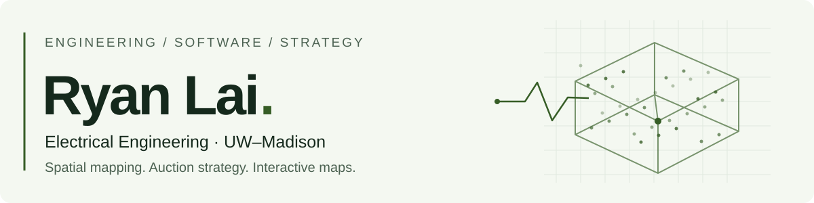
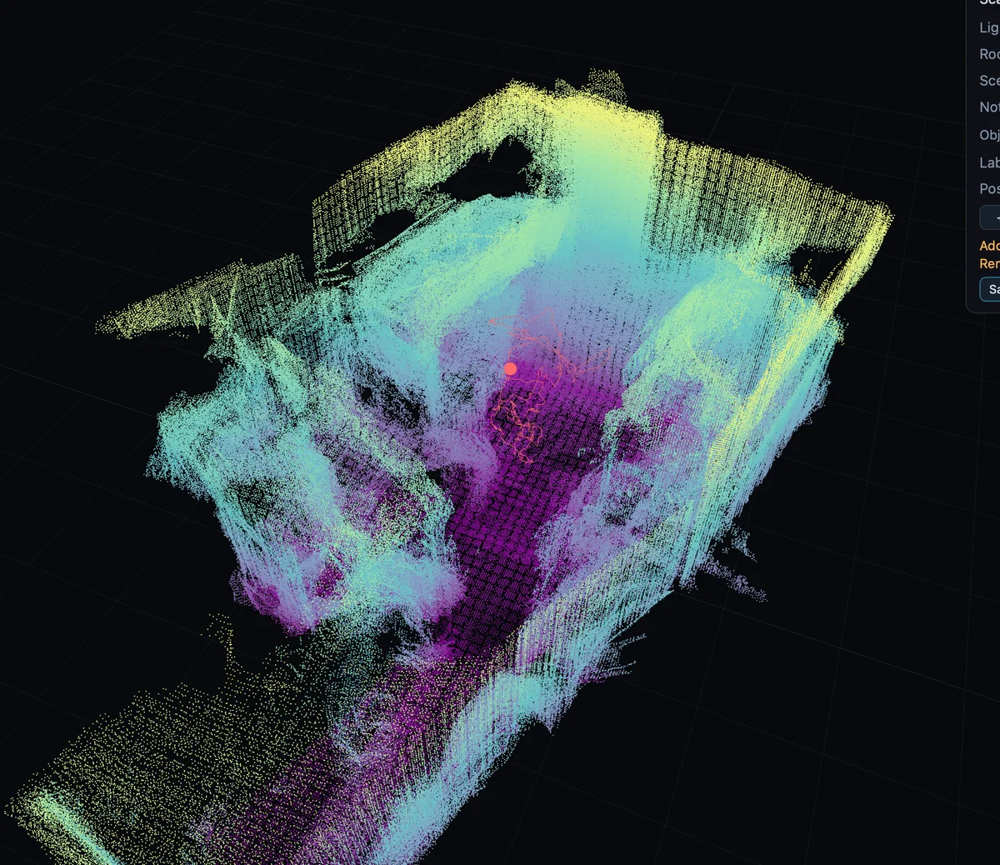

<picture>
  <source media="(prefers-color-scheme: dark)" srcset="assets/profile-dark.svg">
  <source media="(prefers-color-scheme: light)" srcset="assets/profile-light.svg">
  
</picture>

### Electrical Engineering student at UW–Madison

Class of 2030, planning an additional major in Computer Sciences. I build projects that connect sensors, software, and mathematical reasoning.

[Portfolio](https://ryan-lai-portfolio.kimisui227.chatgpt.site/) · [LinkedIn](https://www.linkedin.com/in/ryanboanlai/) · [Email](mailto:ryan.boan.lai@gmail.com)

## Selected work

### [ECHO RESCUE](https://github.com/AkshathCodes/EchoSense)
**MadHacks 2026 · LiDAR mapping · JavaScript**

A phone-to-browser room-mapping prototype built with Charvik, Akshath, and Rishi.

**My work:** mapper-to-viewer integration, spatial memory, room classification, floor-plan exports, and audio cues. I also worked on the HC-SR04 firmware and sonar cross-check.

[Case study](https://ryan-lai-portfolio.kimisui227.chatgpt.site/#project-echo) · [Mapper adapter](https://github.com/AkshathCodes/EchoSense/blob/main/src/mapper-adapter.js) · [Floor-plan code](https://github.com/AkshathCodes/EchoSense/blob/main/src/room-plan.js)

Recording context and prototype scope

The image is from the team's November 15, 2026 phone recordings. Color shows height; orange marks the phone path. Lighting was not recorded. Full-darkness performance, real-scan classification accuracy, and combined real-phone/sonar operation remain unverified. [Original gallery and team documentation](https://github.com/AkshathCodes/EchoSense/blob/0a906a2fe4a9dd1e73a4666b74363942c633c61a/docs/SCANS.md).

### [ALGOGEM Auction Bot](https://github.com/ryanboanlai/algogem-auction-bot)
**Jane Street AMP · Python · Auction strategy**

A bot I built for a four-player sealed-bid gem game. It tracks opponents' holdings, scores reveal choices, and applies fixed bidding rules.

<picture>
  <source media="(max-width: 600px) and (prefers-color-scheme: dark)" srcset="https://raw.githubusercontent.com/ryanboanlai/algogem-auction-bot/main/docs/reveal-strategy-compact-dark.svg">
  <source media="(max-width: 600px) and (prefers-color-scheme: light)" srcset="https://raw.githubusercontent.com/ryanboanlai/algogem-auction-bot/main/docs/reveal-strategy-compact-light.svg">
  <source media="(prefers-color-scheme: dark)" srcset="https://raw.githubusercontent.com/ryanboanlai/algogem-auction-bot/main/docs/reveal-strategy-dark.svg">
  <source media="(prefers-color-scheme: light)" srcset="https://raw.githubusercontent.com/ryanboanlai/algogem-auction-bot/main/docs/reveal-strategy-light.svg">
  
</picture>

Built using the program's provided client. The public repository includes the preserved bot, a runnable offline example, and smoke checks.

[Run the example](https://github.com/ryanboanlai/algogem-auction-bot#try-the-strategy) · [Strategy source](https://github.com/ryanboanlai/algogem-auction-bot/blob/main/strategy.py)

### [Global Flu Tracker](https://github.com/ryanboanlai/Bird-Flu-Tracker)
**HackAppleton 2025 · Second overall · Three-person team**

I built the Leaflet map, toggleable case layers, and location-based proximity scoring with Haversine distance and Nominatim geocoding. The prototype uses demonstration data.

This portfolio fork preserves teammate Akshath's upstream credit and includes a later C++17 HTTP/JSON backend. My contribution described here is to the original browser project.

[Project and team credit](https://github.com/ryanboanlai/Bird-Flu-Tracker#team-and-my-contribution) · [Original repository](https://github.com/AkshathCodes/Bird-Flu-Tracker)

## Background

**Tools:** Python, Java, JavaScript, HTML/CSS, Git, and GitHub.

**Learning:** Programming II, Intro to Computer Engineering, and Multivariable Calculus. Participated in Jane Street's Academy of Math and Programming in 2026.

[Portfolio source](https://github.com/ryanboanlai/ryan-lai-portfolio) includes responsive layouts, native project dialogs, and keyboard navigation.

