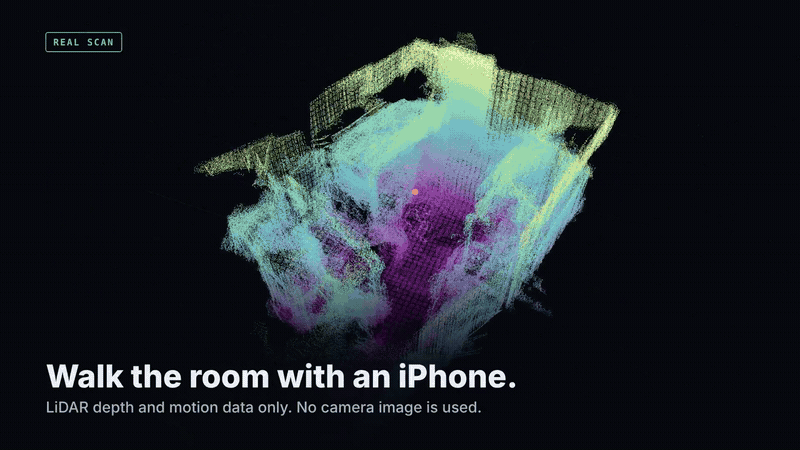

<h1 align="center">Ryan Lai</h1>

  Electrical Engineering student at UW–Madison · Class of 2030 
  Planning an additional major in Computer Sciences

  <a href="https://ryan-lai-portfolio.kimisui227.chatgpt.site/">Website</a>&nbsp; · &nbsp;
  <a href="https://www.linkedin.com/in/ryanboanlai/">LinkedIn</a>&nbsp; · &nbsp;
  <a href="mailto:ryan.boan.lai@gmail.com">Email</a>

## ECHO RESCUE

**iPhone LiDAR room mapping · MadHacks 2026**

<a href="https://github.com/AkshathCodes/EchoSense/blob/c774c839dc74b2860743a243f3d6f4d00e59a12e/docs/media/echosense-demo.mp4">
  <picture>
    <source media="(prefers-reduced-motion: reduce)" srcset="assets/echosense-real-scan.webp">
    
  </picture>
</a>

Recorded phone data from the team's demo. Click to watch the full video.

Built with Charvik, Akshath, and Rishi. I worked on the mapper-to-browser integration, spatial memory, room classification, and floor-plan exports. The repository documents the prototype's test scope.

[Team repository](https://github.com/AkshathCodes/EchoSense) · [My mapper adapter](https://github.com/AkshathCodes/EchoSense/blob/main/src/mapper-adapter.js) · [Floor-plan code](https://github.com/AkshathCodes/EchoSense/blob/main/src/room-plan.js)

## More projects

<table>
  <tr>
    <td width="50%" valign="top">
      <h3><a href="https://github.com/ryanboanlai/algogem-auction-bot">ALGOGEM</a></h3>
      
Python · Jane Street AMP 2026

      

      
A bot I wrote for a four-player gem auction using the program's client and template. It tracks opponents' holdings, follows fixed bidding rules, and scores reveal choices.

      
<a href="https://github.com/ryanboanlai/algogem-auction-bot/blob/main/strategy.py">Read the strategy</a> · <a href="https://github.com/ryanboanlai/algogem-auction-bot#try-the-strategy">Run the example</a>

    </td>
    <td width="50%" valign="top">
      <h3><a href="https://github.com/ryanboanlai/Bird-Flu-Tracker">Global Flu Tracker</a></h3>
      
JavaScript · HackAppleton 2025

      

      
Built with Akshath and Michael. We placed second overall. I worked on the Leaflet map, case-layer toggles, and distance-based proximity scores using demonstration data. The fork also contains a later C++17 API.

      
<a href="https://github.com/ryanboanlai/Bird-Flu-Tracker#build-and-run">Build and run</a> · <a href="https://github.com/AkshathCodes/Bird-Flu-Tracker">Akshath's original repo</a>

    </td>
  </tr>
</table>

About the demo and team credit

The preview is a six-second excerpt from the section labeled **REAL SCAN** in our [team demo](https://github.com/AkshathCodes/EchoSense/blob/c774c839dc74b2860743a243f3d6f4d00e59a12e/docs/media/echosense-demo.mp4). The full video also includes scenes labeled simulated. Real-phone mapping, geometric classification, and the sonar cross-check have different validation scopes; the [team README](https://github.com/AkshathCodes/EchoSense#readme) explains those limits.

The flu tracker link is my portfolio fork of Akshath's repository. Its later C++17 backend is separate from the original browser work described above.

